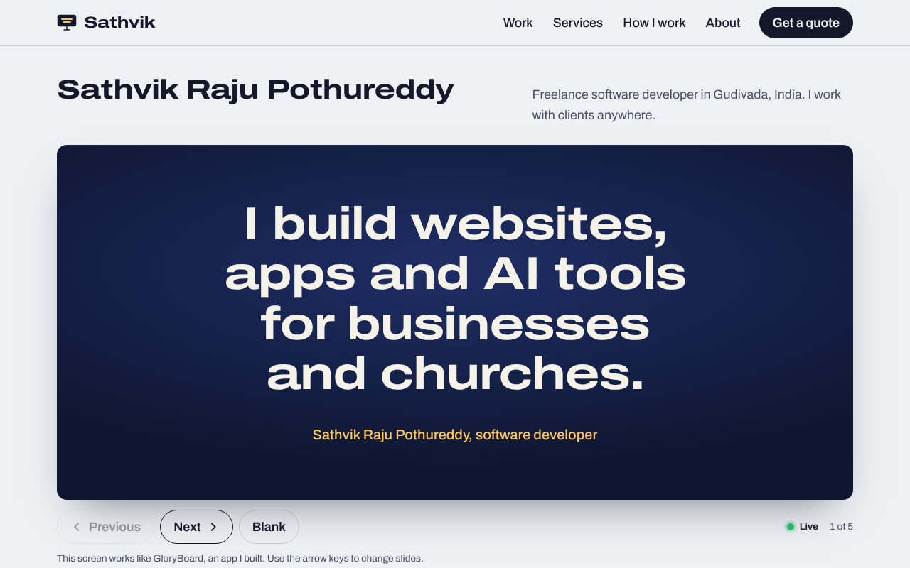
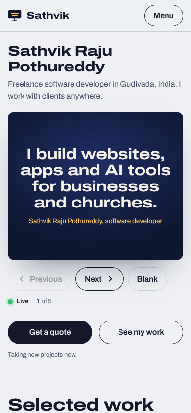
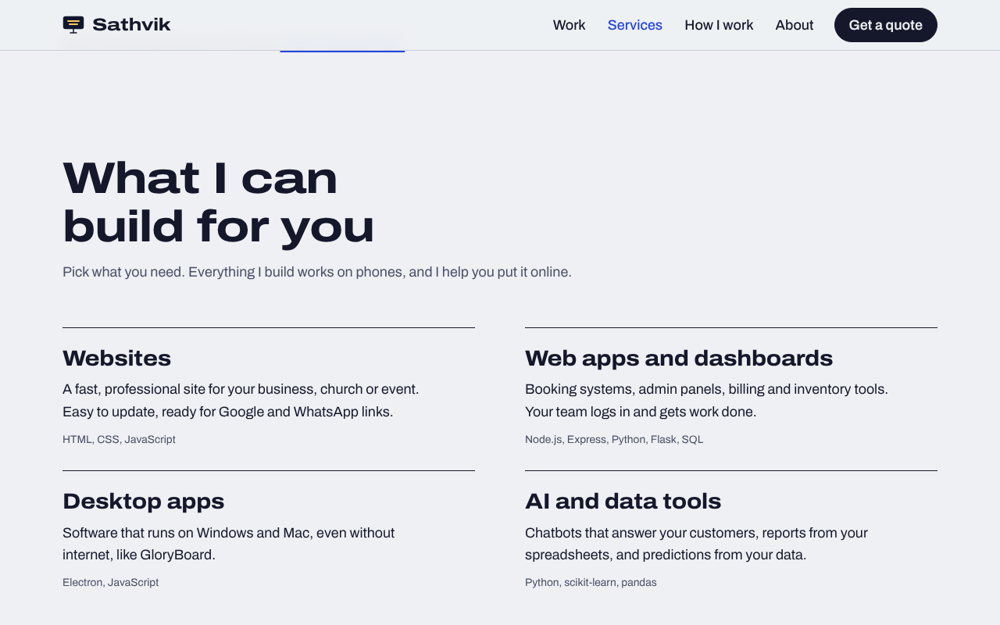

# Sathvik Raju Pothureddy: Portfolio

**My freelance portfolio:** what I build, the work that proves it, and how to hire me. A hand-built static site with no server or build step, hosted free on GitHub Pages.


| Desktop | Phone |
|---|---|
|  |  |

## Contents

- [Design concept](#design-concept)
- [Sections](#sections)
- [Features](#features)
- [Running locally](#running-locally)
- [Publishing on GitHub Pages](#publishing-on-github-pages)
- [Updating the content](#updating-the-content)
- [Project structure](#project-structure)
- [Contact](#contact)

## Design concept

**Stage & drawing set.** The site draws on the two worlds I work in:

- **The stage.** My main project, GloryBoard, puts words on projector screens during church services. The hero is a working projector screen in the same style: short statements in large type with a small gold caption underneath, the way GloryBoard shows a verse reference. An operator console has **Previous**, **Next** and **Blank**, and the arrow keys and `B` work too. It plays through once on load, then the visitor is in control.
- **The drawing set.** I trained as a mechanical engineer. Each project has a **title block** like the corner of an engineering drawing (type, built with, year, how to see it).

| Token | Value | Used for |
|---|---|---|
| Paper | `#EEF0F3` | Page background |
| Ink | `#15182B` | Text, rules, solid buttons |
| Cobalt | `#2445E0` | Links |
| Screen | `#0E1630` | Projector screen and image viewer |
| Lamp | `#FFC857` | Captions on the screen only |

**Type:** one family, [Archivo](https://fonts.google.com/specimen/Archivo), using its width axis: extra-wide for headings and the screen, normal width for reading. The type scale follows a 1.25 ratio.

The slideshow is the only motion that runs by itself. Everything else moves only when the visitor does something.



## Sections

The page is written for clients: what I can build, proof that I can build it, and how to start.

| Section | What it shows |
|---|---|
| **Hero** | Name and location, the projector screen with its console, and **Get a quote** / **See my work** buttons |
| **Selected work** | GloryBoard (lead project) and Liver Health Check, each with a screenshot, summary and title block |
| **Services** | What I can build: websites, web apps and dashboards, desktop apps, AI and data tools |
| **How we'll work together** | Four steps: talk, plan and quote, build with weekly previews, launch and support |
| **About** | Portrait, a short introduction, and my tools and languages |
| **Contact** | Large email link with a **Copy email** button, plus LinkedIn and GitHub |

## Features

### Responsive
Built mobile-first, and tested at 320, 390, 600, 768, 1024, 1280, 1366, 1440 and 1920px widths:

| Screen | Layout |
|---|---|
| Phones | Screen in 4:3.4 format, everything stacked, Menu button |
| 600px and up | 16:10 screen, services and steps 2 per row |
| 900px and up | Inline navigation with a **Get a quote** button; 16:9 screen sized so the console stays above the fold; GloryBoard spans the full width; steps 4 per row |

Text on the projector screen scales with the screen's width and height, so every slide fits at every size.

### Interaction
- **Projector console:** Previous, Next and Blank buttons, arrow keys, `B` to blank, and swipe on touch screens. A **Live / Blank** light shows the screen's state.
- **Image viewer:** opens project screenshots full screen; focus returns to where you were when it closes.
- **Copy email** button with a confirmation message.
- **Current section** marked in the navigation as you scroll.

### Quality
- Light and dark colour schemes that follow the device setting
- Every button and link is at least 44px tall for touch
- Visible keyboard focus, skip link, alt text, and screen-reader labels for the slideshow and title blocks
- Respects reduced motion (no autoplay or slide animation)
- Respects phone notches (`safe-area-inset`)
- WebP images, lazy-loaded below the fold
- Description and Open Graph tags for search and link previews

## Running locally

Open `index.html` in a browser, or serve the folder:

```bash
git clone https://github.com/SathvikRinny/Portfolio.git
cd Portfolio
python3 -m http.server 8000
```

Then open http://localhost:8000.

## Publishing on GitHub Pages

1. In this repository, open **Settings → Pages**.
2. Under **Build and deployment**, choose **Deploy from a branch**.
3. Select branch `main` and folder `/ (root)`, then click **Save**.
4. After about a minute the site is live at **https://sathvikrinny.github.io/Portfolio/**.

## Updating the content

| To change… | Edit |
|---|---|
| Slides on the projector screen | The `<figure class="slide">` blocks in `index.html` (also update “of 5” if you add or remove one) |
| Projects | The `<article class="project">` blocks in `index.html`. The first one has the class `project-lead`. |
| Services | The `<ul class="services">` list in `index.html` |
| Process steps | The `<ol class="steps">` list in `index.html` (numbers are added automatically) |
| About text and tools | The `about` section in `index.html` |
| Project screenshots | `assets/img/projects/` (960×600 WebP) |
| Colours and type sizes | The variables at the top of `assets/css/style.css` (dark mode is in the `prefers-color-scheme: dark` block below them) |
| Email address | `index.html`: the contact section and the last slide |

**Adding a project**

1. Save a 960×600 screenshot as WebP in `assets/img/projects/`.
2. Copy the Liver Health Check `<article class="project">` block in `index.html`, then change the image, text and title block. Projects after the first alternate sides automatically.

## Project structure

```
index.html              Portfolio page
assets/
  css/style.css         Styles and design tokens
  js/main.js            Projector console, menu, image viewer, copy email
  img/profile.webp      Portrait
  img/projects/         Project screenshots
docs/                   Screenshots for this README
```

## Contact

- Email: [sathvikrinny@gmail.com](mailto:sathvikrinny@gmail.com)
- LinkedIn: [linkedin.com/in/sathvik-raju](https://www.linkedin.com/in/sathvik-raju/)
- GitHub: [github.com/SathvikRinny](https://github.com/SathvikRinny)
