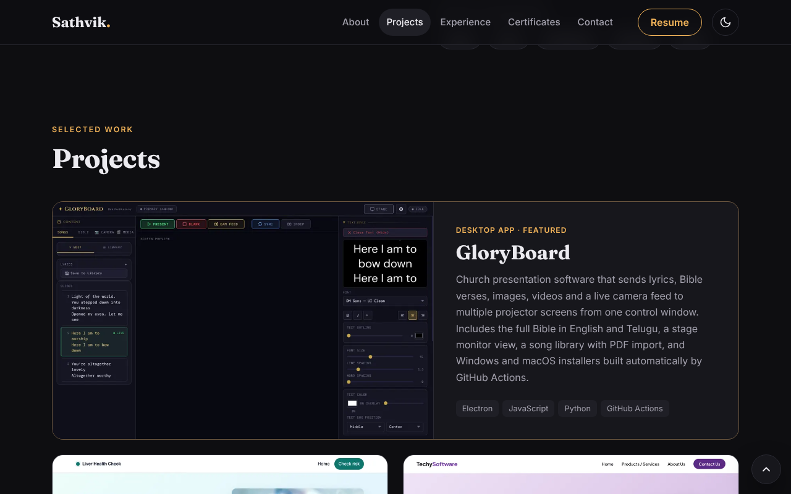

# Sathvik Raju Pothureddy: Portfolio

**My personal portfolio website: who I am, what I've built, where I've worked, and how to reach me.** A fast, responsive static site with a printable resume. It needs no server or build step.


| Desktop | Phone |
|---|---|
|  |  |

## Contents

- [Sections](#sections)
- [Features](#features)
- [Running locally](#running-locally)
- [Publishing on GitHub Pages](#publishing-on-github-pages)
- [Updating the content](#updating-the-content)
- [Project structure](#project-structure)
- [Contact](#contact)

## Sections

| Section | What it shows |
|---|---|
| **Hero** | Photo, name, role, short intro, "Open to work" badge, profile links, and a highlights bar (projects, internships, certificates) |
| **About** | Background and skills grouped by type |
| **Projects** | Cards with real screenshots: GloryBoard (featured), Liver Health Check, Techy Software website, Login & Sign-Up pages, and my engineering capstone |
| **Experience** | Timeline of internships and education |
| **Certificates** | Gallery of 7 certificates; tap any one to open a full-screen viewer |
| **Contact** | Email and profile links, plus a message form |
| **Resume** (`resume.html`) | Clean one-page resume with a **Download PDF** button |

## Features

### Responsive on every screen
The layout is mobile-first and adapts at each size:

| Screen | Layout |
|---|---|
| Phones (under 600px) | Centred hero, single-column projects, 2-column certificate grid, full-screen menu |
| Large phones and small tablets (600px+) | 2-column projects, 3-column certificates |
| Tablets (760px+) | Hero and About side by side, timeline with dates in their own column |
| Laptops (900px+) | Inline navigation, full-height hero, featured project shown side by side, 4-column certificates |
| Desktops (1200px+) | Wider spacing and timeline |

It also respects notches and rounded corners (`safe-area-inset`), keeps every tap target at least 44px, and uses 16px form text so iPhones don't zoom in.

### Everything else
- **Light and dark themes:** follows the device setting, with a toggle in the header that remembers your choice
- **Full-screen mobile menu** that locks page scrolling and closes with Esc or a tap on a link
- **Active section** highlighted in the menu as you scroll
- **Certificate viewer:** previous/next buttons, arrow keys and swipe gestures
- **Back-to-top button** after you scroll past the first screen
- **Contact form without a server:** it checks the fields, then opens the visitor's email app with the message filled in
- **Printable resume:** `resume.html` has print styles, so **Download PDF** (or Ctrl/Cmd + P) gives a clean PDF
- **Accessible:** skip link, labelled fields, visible focus outlines, alt text, reduced-motion support
- **Fast:** WebP images, lazy-loaded below the fold
- **SEO and sharing tags** (description, Open Graph, theme colour)



## Running locally

Open `index.html` in a browser, or serve the folder:

```bash
git clone https://github.com/SathvikRinny/Portfolio.git
cd Portfolio
python3 -m http.server 8000
```

Then open http://localhost:8000.

## Publishing on GitHub Pages

1. In this repository, open **Settings → Pages**.
2. Under **Build and deployment**, choose **Deploy from a branch**.
3. Select branch `main` and folder `/ (root)`, then click **Save**.
4. After about a minute the site is live at **https://sathvikrinny.github.io/Portfolio/**.

## Updating the content

| To change… | Edit |
|---|---|
| Intro, about text or skills | The `hero` and `about` sections in `index.html` |
| Projects | The `<article class="project">` blocks in `index.html` |
| Experience | The `<ol class="timeline">` list in `index.html` |
| Resume | `resume.html` |
| Project screenshots | `assets/img/projects/` (960×600 WebP) |
| Colours and fonts | The variables at the top of `assets/css/style.css` (dark theme in `:root`, light theme in `[data-theme="light"]`) |
| Contact email | `index.html`, `resume.html`, and `EMAIL` at the top of `assets/js/main.js` |

**Adding a certificate**

1. Add two images to `assets/img/certs/`: a large one (about 1400px wide) and a `-thumb` version (about 520px wide). WebP is recommended.
2. Copy one of the `<button class="cert">` blocks in `index.html` and update `data-full`, `data-title`, the `` and the caption.

## Project structure

```
index.html              Portfolio page
resume.html             Printable resume
assets/
  css/style.css         Styles
  js/main.js            Theme, menu, scroll effects, certificate viewer, contact form
  img/profile.webp      Profile photo
  img/projects/         Project screenshots
  img/certs/            Certificate images and thumbnails
docs/                   Screenshots for this README
```

## Contact

- Email: [sathvikrinny@gmail.com](mailto:sathvikrinny@gmail.com)
- LinkedIn: [linkedin.com/in/sathvik-raju](https://www.linkedin.com/in/sathvik-raju/)
- GitHub: [github.com/SathvikRinny](https://github.com/SathvikRinny)
